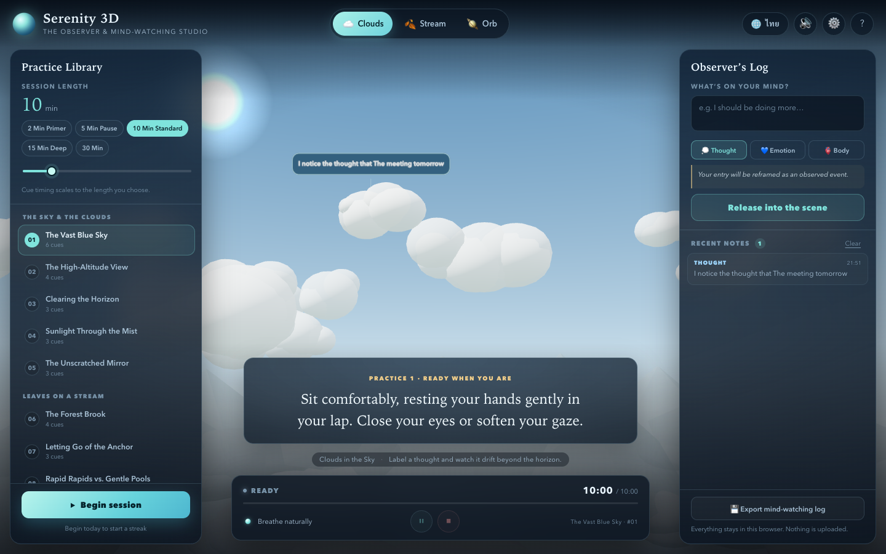

# Serenity 3D Studio — OpenCode skill

An installable OpenCode skill for building a bilingual, static 3D mind-watching app: twenty guided
observer practices, cloud / stream / breathing-orb worlds, cognitive-defusion labeling, Web Speech
narration, Web Audio gong and ambience, scaled session timing, local history, headless verification and
a GitHub Pages release.

This repository is the **backup / distribution copy** of the skill used to build
[Serenity 3D — The Observer & Mind-Watching Studio](https://somphol.github.io/serenity-3d-studio/)
([source](https://github.com/somphol/serenity-3d-studio)).



## Install from the catalog

Add this base URL to your OpenCode config:

```jsonc
{
  "$schema": "https://opencode.ai/config.json",
  "skills": ["https://somphol.github.io/serenity-3d-studio-skill/"]
}
```

OpenCode fetches [`index.json`](index.json), downloads the listed files under
[`serenity-3d-studio/`](serenity-3d-studio/), and registers the folder as the skill ID
`serenity-3d-studio`. Use it when asking for a 3D mindfulness, observer, meditation, cognitive-defusion
or bilingual guided-practice app.

## Install manually

```bash
cp -R serenity-3d-studio ~/.config/opencode/skills/serenity-3d-studio
```

## Scaffold a project

```bash
cd serenity-3d-studio
node scripts/scaffold.mjs ~/Projects/my-observer-studio
cd ~/Projects/my-observer-studio
python3 -m http.server 8080
node scripts/verify-browser.mjs
```

The scaffold copies the working reference (`index.html`, `style.css`, `script.js`, browser verifier) and
writes starter `README.md`, `AGENTS.md`, `package.json` and `.nojekyll`. The output is a runnable bilingual
app with 20 sample practices; rewrite the content and design for the new product.

## What the skill covers

| File | Contents |
| --- | --- |
| [`SKILL.md`](serenity-3d-studio/SKILL.md) | when to use, gates, non-negotiables, phase workflow, recipes |
| [`references/method.md`](serenity-3d-studio/references/method.md) | content contract, persistence, session engine, scene/audio/TTS recipes |
| [`references/verification.md`](serenity-3d-studio/references/verification.md) | static, in-app, headless and manual testing |
| [`references/lessons.md`](serenity-3d-studio/references/lessons.md) | sixteen real bugs and fixes |
| [`references/release.md`](serenity-3d-studio/references/release.md) | docs, `state.json`, GitHub Pages, skill publishing |
| [`assets/reference/`](serenity-3d-studio/assets/reference/) | runnable Three.js app + verifier |
| [`scripts/scaffold.mjs`](serenity-3d-studio/scripts/scaffold.mjs) | tested scaffold command |

## Verify the backup

```bash
node ~/.config/opencode/skills/skill-publish/scripts/check-skill.mjs ./serenity-3d-studio
node serenity-3d-studio/scripts/scaffold.mjs /tmp/serenity-try
cd /tmp/serenity-try && node scripts/verify-browser.mjs
```

The original build recorded 12/12 in-app self-tests, 6/6 headless DOM checks, a session/log smoke test
and zero uncaught console errors.

## Credits

Skill authored from the Serenity 3D build by **OpenCode + DeepSeek V4.1 Flash**, from a specification by
Somphol Boonjing. Three.js r128 (MIT) is loaded from a CDN and is not vendored. See
[ATTRIBUTION.md](ATTRIBUTION.md).

## License

MIT — see [LICENSE](LICENSE).
