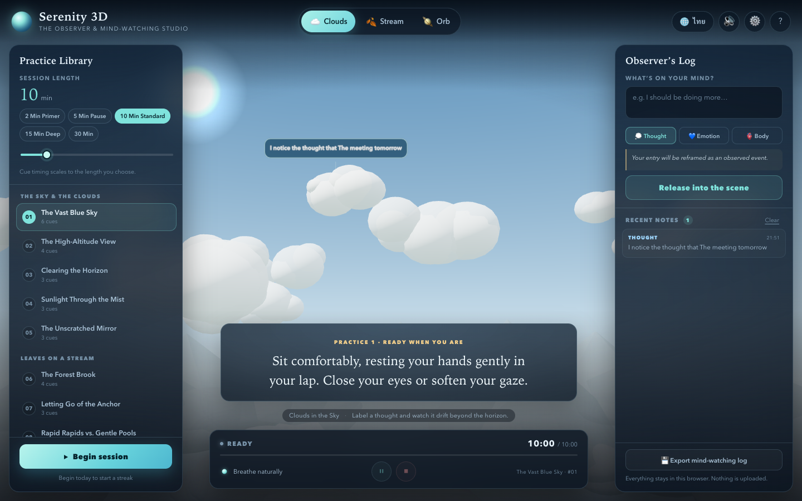

# Serenity 3D Studio

An OpenCode skill for building and shipping a bilingual, static 3D mind-watching app: twenty guided
observer practices, cloud/stream/orb worlds, cognitive-defusion labeling, Web Speech narration, a
synthesised gong and ambience, scaled session timing, local history and a verified GitHub Pages release.

Built from the completed **Serenity 3D — The Observer & Mind-Watching Studio** project
([source](https://github.com/somphol/serenity-3d-studio),
[live](https://somphol.github.io/serenity-3d-studio/)) — 12/12 in-app self-tests, 6/6 headless DOM checks
and zero uncaught runtime errors.



## Install

Copy this folder into `~/.config/opencode/skills/serenity-3d-studio`, or add the skills directory that
serves it to your OpenCode config.

## Use

Ask for a 3D mindfulness / observer / cognitive-defusion app, or for a bilingual guided-practice studio
with clouds, a stream or a breathing orb. The skill covers the content contract, session state machine,
Three.js scene recipes, audio and speech, verification, documentation and publishing.

## Scaffold

```bash
node scripts/scaffold.mjs ~/Projects/my-observer-studio
cd ~/Projects/my-observer-studio
python3 -m http.server 8080
node scripts/verify-browser.mjs
```

The scaffold contains the working reference (`index.html`, `style.css`, `script.js`, verifier) and starter
metadata. Rewrite the practices and copy for the new product.

## What is inside

```text
SKILL.md                    when to use, gates, non-negotiables, workflow
references/method.md        content/persistence/session/scene/audio recipes
references/verification.md  static, in-app, headless and manual layers
references/lessons.md       sixteen real bugs and fixes
references/release.md       docs, state.json, GitHub, Pages, skill backup
assets/reference/           runnable app + browser verifier
assets/preview.png
scripts/scaffold.mjs
```

## Attribution

Original project code and copy by Somphol Boonjing, built with OpenCode + DeepSeek V4.1 Flash. Three.js
r128 (MIT) is loaded from a CDN and is not vendored. See [ATTRIBUTION.md](ATTRIBUTION.md).

## License

MIT — see [LICENSE](LICENSE).
